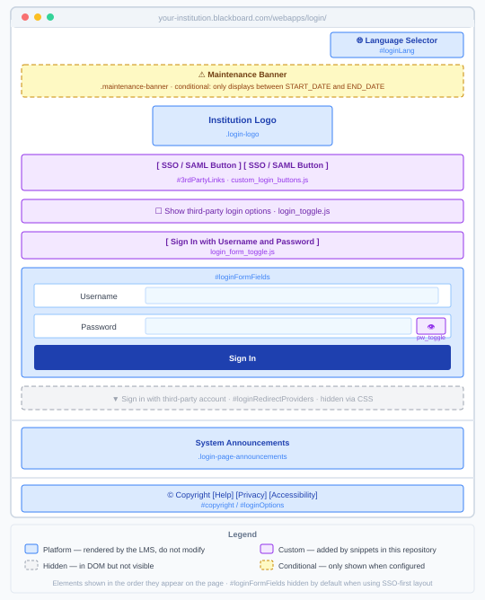

# Blackboard LMS Login Page Customization Toolkit

Blackboard LMS lets you customize the login page by downloading its `login-ultra.jsp` template, editing it, and uploading it back through System Admin — but the template itself is mostly things you shouldn't touch. This repo is the part that's actually meant to be edited: small, independent CSS and JavaScript files you drop into that template to add features like SSO buttons, a password-visibility toggle, or a maintenance banner — plus reference copies of Blackboard's own templates so you know what you're starting from and what changed between releases. Nothing here touches authentication logic.



## What's included

The snippets below are what you actually add to your login page. Each is a self-contained file — drop in only the ones you want, in the load order noted in `templates/README.md`.

| Snippet | File | What it does |
|---------|------|--------------|
| Shared config | `js/login_config.js` | Brand/behavior settings (banner message and dates, default toggle states) read by every snippet below. Load this first. |
| Third-party login buttons | `js/custom_login_buttons.js` | Clones SSO/SAML provider links from the platform dropdown into a visible, styled button area (`#3rdPartyLinks`) |
| Third-party toggle | `js/login_toggle.js` | Adds a button to show/hide the `#3rdPartyLinks` button area |
| Direct login toggle | `js/login_form_toggle.js` | Adds a button to show/hide the username/password fields — useful when SSO is the primary login method |
| Maintenance banner | `js/maintenance_banner.js` | Shows a date-bounded, dismissible notice above the login form |
| Password visibility toggle | `examples/password_toggle.html` | Adds a show/hide eye button to the password field |
| Styles | `css/login_styles.css` | CSS for all snippets above; set `--bb-brand-color` to your institution's color |

See `unified_blackboard_login_customization_guide.md` for full setup instructions, safe customization areas, accessibility guidance, and maintenance recommendations.

## Guided setup

*In development, not yet published in this repo.* A `/customize-login` Claude Code
command will walk you through picking features, filling in `js/login_config.js`
and your brand color, and assembling a ready-to-upload `login_ultra.jsp` for your
institution. Until it ships, follow the guide and the annotated template.

## Repository structure

```
js/
  login_config.js             Shared settings read by every snippet below — load first
  custom_login_buttons.js     Clone provider links into #3rdPartyLinks
  login_toggle.js             Button toggle for #3rdPartyLinks
  login_form_toggle.js        Button toggle for #loginFormFields
  maintenance_banner.js       Date-bounded status banner
css/
  login_styles.css            All styles; set --bb-brand-color here
  ultra_*.css                  Blackboard's own ultra.css, pulled for reference — not ours, not for upload
  _login.scss / _global.scss    Blackboard/Foundation source, reference only — see css/README.md
examples/
  password_toggle.html        Password show/hide eye button
templates/
  login-ultra_*.jsp           Unmodified Blackboard templates by version
  annotated_login_*.jsp       Annotated versions with injection points marked
  archive/                    Releases more than 6 months old
reference/
  screenshots/                 Full-page captures of the default login page, by version/date
  dom/                          Rendered-DOM captures, by version/date
  admin_config_effects.md       System Admin settings that change what renders on the login page
  mods_to_login-utra-jsp.txt    Legacy reference (original older-style snippets)
unified_blackboard_login_customization_guide.md   Full customization guide
```

## Resources

- [Anthology Help – Customize the Login Page](https://help.anthology.com/blackboard/administrator/en/configure-blackboard/customize-the-login-page.html) (official download/upload/reset steps and navigation)
- Collaborate Recording: [Watch here](https://us.bbcollab.com/recording/de225e5bb3af44f3a5258708606b24a6) (ends at 11:11)

---

Always back up your unedited template before uploading changes. Revalidate customizations after each Blackboard LMS SaaS release.
